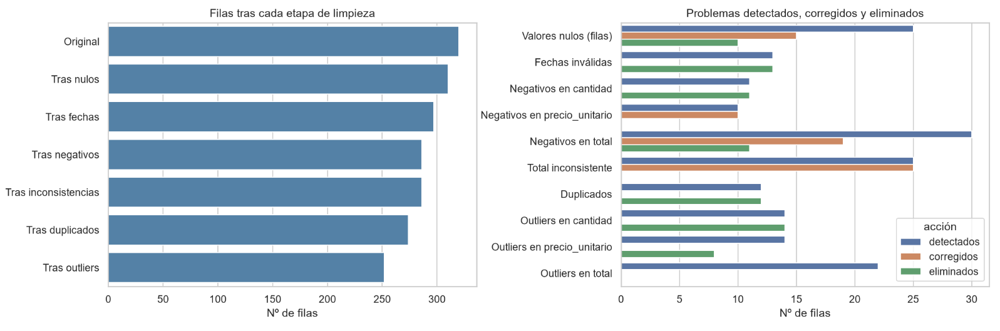
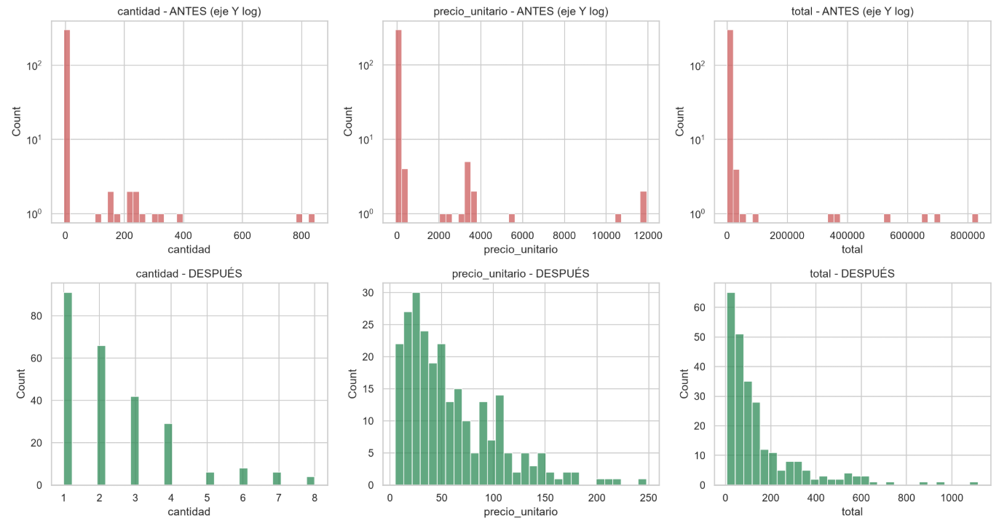
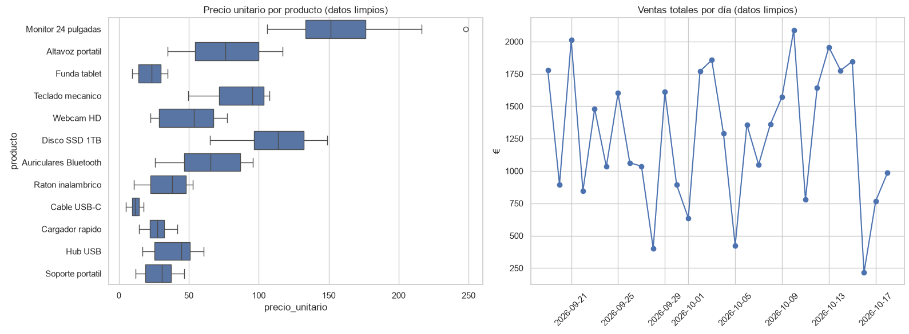

# Sistema de Calidad y Limpieza de Datos de Ventas

**Python · Pandas · NumPy · Matplotlib · Seaborn**

## 1. Descripción del proyecto

Este proyecto consiste en desarrollar un sistema automatizado de **detección, validación y limpieza de datos de ventas** mediante Python.

En los entornos empresariales, los datos procedentes de sistemas de ventas pueden contener información incompleta, registros duplicados, fechas inválidas o inconsistencias en los importes. Estos problemas pueden afectar a los informes comerciales, al análisis de ingresos y a la toma de decisiones.

Para abordar este problema, he desarrollado un script que analiza un archivo CSV con datos de ventas, identifica diferentes problemas de calidad, aplica técnicas de limpieza y genera un informe con los resultados obtenidos.

El objetivo es transformar un conjunto de datos potencialmente poco fiable en una fuente de información más consistente, documentando las modificaciones realizadas y facilitando su posterior análisis.

## 2. Problema que resuelve

La calidad de los datos es fundamental para cualquier sistema de análisis empresarial. Si la información de partida contiene errores, los resultados obtenidos pueden ser incorrectos y conducir a decisiones equivocadas.

Este proyecto aborda seis categorías de problemas:

- **Valores nulos:** campos críticos incompletos, como la fecha, el producto, la cantidad, el precio unitario o el total de la venta.
- **Fechas inválidas:** registros cuyas fechas no cumplen el formato esperado o no representan fechas válidas.
- **Valores negativos:** cantidades, precios o importes negativos que deben revisarse según las reglas de negocio.
- **Inconsistencias en los importes:** diferencias entre el total registrado y el resultado de multiplicar la cantidad por el precio unitario.
- **Valores atípicos (*outliers*):** cantidades, precios e importes que se alejan considerablemente de los valores habituales.
- **Registros duplicados:** ventas repetidas que pueden distorsionar las estadísticas y los resultados del análisis.

La solución automatiza estas comprobaciones y aplica diferentes estrategias para recuperar, corregir o descartar registros según el tipo de problema.

## 3. Tecnologías utilizadas

| Tecnología | Aplicación en el proyecto |
|---|---|
| Python | Desarrollo de la lógica de procesamiento y limpieza. |
| Pandas | Carga de archivos CSV, manipulación de datos, detección de errores y cálculo de estadísticas. |
| NumPy | Operaciones numéricas, gestión de valores ausentes y comparación de importes con tolerancias. |
| Matplotlib | Creación y configuración de visualizaciones. |
| Seaborn | Representación estadística de distribuciones, comparaciones y diagramas de caja. |

## 4. Funcionamiento del sistema

El proceso se divide en varias etapas para facilitar el seguimiento de las transformaciones realizadas.

### 4.1. Carga y exploración inicial

El script carga el archivo `ventas_con_problemas.csv` y realiza una exploración inicial para conocer la estructura del conjunto de datos.

Entre las comprobaciones realizadas se encuentran:

- Número de filas y columnas.
- Visualización de los primeros registros.
- Identificación de los tipos de datos.
- Recuento de valores nulos por columna.
- Detección inicial de filas duplicadas.
- Estadísticas descriptivas de los campos numéricos.

La información original también se conserva en memoria para poder comparar las distribuciones antes y después de la limpieza.

### 4.2. Tratamiento de valores nulos

Se comprueban los campos considerados críticos para determinar qué registros pueden recuperarse.

La estrategia aplicada es la siguiente:

- Se eliminan las filas que carecen de fecha o producto, ya que estos datos no pueden reconstruirse de forma fiable con la información disponible.
- Se intenta recuperar la cantidad cuando se conocen el precio unitario y el total, siempre que el resultado sea compatible con una cantidad entera.
- Se intenta recuperar el precio unitario cuando se conocen la cantidad y el total.
- Se recalcula el total cuando se dispone de una cantidad y un precio válidos.
- Se eliminan los registros que continúan teniendo campos numéricos esenciales sin resolver.

De esta manera, se intenta conservar la mayor cantidad posible de información sin inventar valores arbitrarios.

### 4.3. Validación de fechas

Las fechas se convierten al formato esperado `YYYY-MM-DD`.

Los valores que no pueden interpretarse correctamente se identifican como inválidos y se eliminan del conjunto limpio, dado que no pueden utilizarse de forma fiable en los análisis temporales.

### 4.4. Detección y tratamiento de valores negativos

Se analizan por separado las cantidades, los precios unitarios y los totales.

El tratamiento implementado sigue estos criterios:

- **Cantidades negativas:** se eliminan, bajo la hipótesis de que el conjunto representa ventas y no devoluciones.
- **Precios unitarios negativos:** se corrigen utilizando su valor absoluto.
- **Totales negativos:** se recalculan a partir de la cantidad y el precio unitario.

Estos criterios responden a las reglas asumidas para este ejercicio. En un sistema empresarial real, sería necesario comprobar si los valores negativos representan devoluciones, abonos u otras operaciones legítimas antes de eliminarlos o modificarlos.

### 4.5. Comprobación de la consistencia de los totales

Se compara el importe registrado con el resultado de multiplicar la cantidad por el precio unitario.

Se utiliza una tolerancia de un céntimo para evitar considerar incorrectas pequeñas diferencias de redondeo.

Cuando se detecta una inconsistencia, el total se recalcula utilizando la cantidad y el precio unitario disponibles, redondeando el resultado a dos decimales.

Este control ayuda a mantener la coherencia aritmética de los registros de ventas.

### 4.6. Eliminación de duplicados

Se buscan registros repetidos utilizando los campos críticos de la venta.

Se conserva la primera aparición y se eliminan las repeticiones posteriores. Esta operación se realiza antes del análisis de valores atípicos para reducir la influencia de los registros duplicados sobre las distribuciones estadísticas.

En un sistema real, sería preferible utilizar un identificador único de transacción cuando estuviera disponible, para distinguir los duplicados auténticos de las compras legítimas con los mismos valores.

### 4.7. Detección de valores atípicos

Para detectar valores atípicos se utiliza el método del rango intercuartílico, conocido como IQR (*Interquartile Range*).

Este método establece límites a partir de los cuartiles de la distribución y permite identificar observaciones que se encuentran alejadas de los valores centrales.

En este proyecto se aplica un factor de 3 sobre el rango intercuartílico, utilizando un criterio más conservador que el umbral habitual de 1,5.

La estrategia varía según el campo analizado:

- **Cantidad:** se calcula el rango de referencia sobre el conjunto de datos.
- **Precio unitario:** se calculan los límites por producto para tener en cuenta que cada producto puede presentar precios habituales diferentes.
- **Total:** se utilizan también rangos específicos por producto.

Los registros identificados como atípicos se excluyen del conjunto final.

Este tratamiento constituye una regla de limpieza para el ejercicio; en un entorno real, los valores señalados deberían revisarse para confirmar que representan errores y no ventas legítimas de importe elevado.

### 4.8. Validaciones finales

Una vez terminada la limpieza, los registros se ordenan por fecha y se comprueba que el conjunto resultante cumple las condiciones establecidas:

- No existen valores nulos en los campos críticos.
- Los campos numéricos son positivos.
- Los totales coinciden con la cantidad multiplicada por el precio unitario, dentro de la tolerancia definida.
- No existen registros duplicados exactos.

Si alguna de estas condiciones no se cumple, las comprobaciones mediante `assert` permiten detectar el problema durante la ejecución.

## 5. Informe de calidad de datos

El programa genera automáticamente un informe de texto llamado `informe_calidad.txt`.

Este informe recoge:

- Número de filas originales.
- Número de filas después de la limpieza.
- Cantidad y porcentaje de filas eliminadas.
- Valores nulos detectados inicialmente por columna.
- Problemas identificados, corregidos y eliminados por categoría.
- Evolución del número de filas durante las diferentes etapas.
- Media, mediana y desviación estándar de los campos numéricos limpios.

El informe permite comprobar qué transformaciones se han realizado y evaluar el efecto general del proceso de limpieza.

Para interpretar los recuentos correctamente, hay que tener en cuenta que una misma fila puede presentar varios problemas. El sistema contabiliza las eliminaciones por etapas, por lo que las filas eliminadas no equivalen necesariamente a la suma de todos los problemas detectados.

## 6. Visualizaciones

El proyecto genera tres archivos gráficos para facilitar la interpretación de los resultados.

### Figura 1. Resumen del proceso de limpieza



Incluye dos gráficos:

- Evolución del número de filas después de cada etapa.
- Comparación del número de problemas detectados, corregidos y eliminados por categoría.

Permite visualizar cuánto cambia el conjunto de datos durante el proceso.

### Figura 2. Distribución antes y después de la limpieza



Compara las distribuciones de cantidades, precios unitarios y totales antes y después de la limpieza.

El gráfico de los datos originales utiliza una escala logarítmica en el eje vertical para facilitar la visualización de distribuciones con frecuencias muy diferentes.

Esta comparación ayuda a identificar cómo afectan las transformaciones y eliminaciones a la distribución de los datos.

### Figura 3. Análisis de productos y ventas diarias



Contiene dos visualizaciones:

- Diagramas de caja de los precios unitarios por producto.
- Evolución de las ventas totales agregadas por día.

Estos gráficos permiten observar las diferencias de precios entre productos y analizar la evolución temporal de los importes registrados en el conjunto limpio.

## 7. Archivos generados

Al ejecutar el programa se generan los siguientes archivos:

| Archivo | Descripción |
|---|---|
| `ventas_limpias.csv` | Conjunto de datos resultante del proceso de limpieza. |
| `informe_calidad.txt` | Informe con los recuentos, las etapas y las estadísticas descriptivas. |
| `fig1_resumen_limpieza.png` | Resumen gráfico de las etapas y los problemas tratados. |
| `fig2_distribuciones_antes_despues.png` | Comparación de las distribuciones originales y limpias. |
| `fig3_productos_y_ventas_diarias.png` | Análisis de precios por producto y ventas diarias. |

El archivo CSV original se utiliza como entrada y no se sobrescribe.

## 8. Estructura del proyecto

```text
01-limpieza-datos-ventas/
├── ventas_con_problemas.csv
├── limpieza_ventas.py
├── ventas_limpias.csv
├── informe_calidad.txt
├── fig1_resumen_limpieza.png
├── fig2_distribuciones_antes_despues.png
├── fig3_productos_y_ventas_diarias.png
└── README.md
```

Los archivos de salida se generan al ejecutar el script, por lo que no es necesario crearlos manualmente.

## 9. Instalación y ejecución

### Requisitos

- Python 3.
- Pandas.
- NumPy.
- Matplotlib.
- Seaborn.

### Instalar las dependencias

Desde la terminal, ejecuta:

```bash
pip install pandas numpy matplotlib seaborn
```

### Preparar los archivos

Coloca `ventas_con_problemas.csv` en el mismo directorio que `limpieza_ventas.py`.

El CSV debe contener las columnas esperadas por el programa:

- `fecha`
- `producto`
- `cantidad`
- `precio_unitario`
- `total`

### Ejecutar el programa

```bash
python limpieza_ventas.py
```

Durante la ejecución, el programa muestra la exploración inicial, el informe final y las visualizaciones. También guarda los resultados generados en el directorio de trabajo.

## 10. Objetivos de aprendizaje

Este proyecto me permite aplicar y reforzar conocimientos relacionados con:

- Manipulación y transformación de datos mediante Pandas.
- Validación de datos y tratamiento de valores ausentes.
- Limpieza de datos y detección de inconsistencias.
- Aplicación de métodos estadísticos para identificar valores atípicos.
- Generación de informes automatizados.
- Visualización de datos con Matplotlib y Seaborn.
- Verificación de condiciones de calidad mediante aserciones.
- Organización de un flujo de procesamiento de datos reproducible.

## 11. Posibles mejoras futuras

Como evolución del proyecto, sería interesante incorporar:

- Pruebas automatizadas para validar cada regla de limpieza.
- Un registro detallado de las modificaciones realizadas en cada fila.
- Un sistema de configuración para adaptar las reglas a diferentes conjuntos de datos.
- Identificadores únicos de transacción para mejorar la detección de duplicados.
- Validaciones específicas para devoluciones, descuentos e impuestos.
- Un dashboard interactivo para consultar los resultados de calidad.
- Integración con una base de datos para procesar datos procedentes de diferentes fuentes.

## Conclusión

Este proyecto demuestra cómo utilizar Python para automatizar un proceso de control de calidad de datos, desde la exploración inicial hasta la generación de un conjunto limpio, un informe y varias visualizaciones.

La solución proporciona una base para preparar datos de ventas destinados a análisis posteriores y muestra la importancia de validar la información antes de utilizarla para generar estadísticas o apoyar decisiones empresariales.

Forma parte de mis proyectos prácticos desarrollados durante la especialización en Inteligencia Artificial y Big Data, con el objetivo de aplicar los conocimientos adquiridos a problemas relacionados con el procesamiento y la calidad de los datos.
